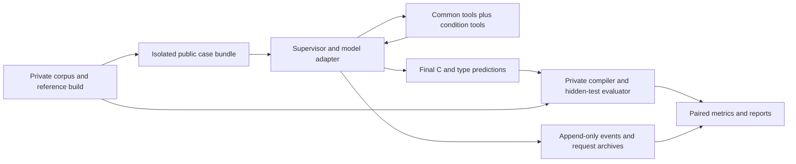

# Raw, REA, and WebAsmIR recovery benchmark

Design date: 2026-11-12. Status: protocol and guidance draft. A Codex CLI launcher
now implements a bounded static-analysis profile; see [launch instructions](LAUNCH.md).
The full multi-provider supervisor and hidden-test evaluator described here
remain future work.

Compare **the same model on the same stripped binary** in three conditions:
raw evidence, REA with its skill and native backend, and WebAsmIR MCP with its
guidance. Measure executable source recovery and structural type recovery
separately, alongside total tokens, peak context, latency, and tool overhead.

The main experiment estimates the effect of each complete workflow. It cannot
attribute an improvement solely to a skill, an MCP transport, or a decompiler.
Use the ablations below for those questions.

## 1. What this repository already provides

Reviewed baseline: `ef1f879f21889ffacb2723832a43f855749bb7a7`.

| Component | Current behavior | Benchmark implication |
|---|---|---|
| [`mcp_server.py`](../src/asmwebir/mcp_server.py) | `asmwebir-mcp` entry point; stdio by default; 11 text-returning tools over `Session` | Exercise the real MCP connection in the main WebAsmIR condition |
| [`session.py`](../src/asmwebir/session.py) | Views, holes, claims, contradiction witnesses, retractions, explanation, completion checks | Good interaction and diagnostic layer; completion is not source correctness |
| [`angr_frontend.py`](../src/asmwebir/lift/angr_frontend.py) | ELF x86-64 SysV lifting using angr 9.2.147, with residuals for unsupported code | Publish lifting coverage and failures; do not silently filter difficult cases |
| [`harness/loop.py`](../src/asmwebir/harness/loop.py) | Anthropic-specific type-recovery loop; direct `Session` calls; response replay cache; per-turn usage | Reuse ideas, but this is neither a multi-provider runner nor an MCP benchmark |
| [`eval/score.py`](../src/asmwebir/eval/score.py) | Selected parameter/return kind, pointer depth, layout, and exact-type comparisons with DWARF | Useful engine diagnostic; cannot score all methods' recovered C directly |
| [`eval/report.py`](../src/asmwebir/eval/report.py) | Creates a fresh premise-only store for each case | Existing reports do not score the final agent-edited store |
| [`emit/`](../src/asmwebir/emit/__init__.py) | No recovered-C emitter | Every model must still write `recovered.c`; IR views are not compilable C |
| [`tools/build_fixtures.sh`](../tools/build_fixtures.sh), [`tools/sweep.py`](../tools/sweep.py) | Depend on the sibling `llm-decompile-test` repository | Pin both repositories and build the missing corpus artifacts before runs |

The sibling repository supplies 20 C programs, reduced-output variants,
GCC/binutils build scripts, an objdump baseline, and a recovered-C evaluator.
Its existing programs have fixed inputs; its evaluator documentation correctly
calls the behavioral metric **single-vector re-executability**. Reuse these
for development and compatibility, not as the sole semantic benchmark.
The expected `artifacts_result_only/` directory was absent at inspection time.

Local checks: the existing test suite passed (22 tests). A real stdio client
initialized the server, discovered all 11 tools, and opened `tiny.O1.stripped`.
It also reported invalid JSON-RPC caused by diagnostic stdout from lifting.
The launcher implementation subsequently redirected engine diagnostics to stderr
and added a real MCP regression test for this issue.

### MCP deployment and isolation

The installed command is `.venv/bin/asmwebir-mcp`, defined in
[`pyproject.toml`](../pyproject.toml). An equivalent source-oriented launch is:

```sh
PYTHONPATH="$PWD/src" .venv/bin/python -m asmwebir.mcp_server
```

This starts a protocol server, not an interactive shell command. The benchmark
supervisor should launch it with an absolute interpreter path, an absolute
`PYTHONPATH`, piped stdin/stdout, and stderr captured separately. Snapshot the
MCP initialize response, server instructions, and actual `tools/list` schemas.
The supervisor must explicitly deliver server instructions to the model; an
MCP initialization response alone does not guarantee a host will do that.

`open_binary(path)` caches sessions by path in process-global `_sessions` and
selects the current session through `_current`. Reopening the same path does
**not** reset claims. There is no reset/close tool or session-id argument.
Use a new server process per trial and serialize its calls. Parallel trials
need separate processes, workspaces, and backend databases. Canonicalize the
input path to `/input/program.elf` and keep the evaluator's corpus names private.

## 2. Conditions and the meaning of “raw”

All conditions get the same neutral task prompt, architecture/ABI description,
input contract, raw evidence access, output contract, public compiler/test
feedback, and resource limits. Only the analysis tools and guidance change.

| ID | Analysis evidence and tools | Guidance |
|---|---|---|
| `raw` | Canonical disassembly, ELF metadata, section bytes, imports/relocations; common file/build tools | Neutral task prompt only |
| `rea` | Everything in `raw`, plus REA MCP with one pinned native backend | Pinned upstream `reverse-engineer-anything` skill and its reference files |
| `webasmir` | Everything in `raw`, plus this repository's MCP | Server instructions plus [`skills/webasmir-recovery/SKILL.md`](skills/webasmir-recovery/SKILL.md) |

Here “raw” means an agent working from raw binary evidence, with no decompiler
or specialized RE guidance. It can read evidence in chunks, write C, and obtain
the same bounded public compiler/test feedback as the other conditions.
If a strictly one-shot, tool-free baseline is desired, call it `raw-one-shot`
and report it separately; restricting only that condition's revision budget
would answer a different question.

Use complete binary evidence for whole-program recovery. An `objdump -d`-only
listing omits data and strings needed to reconstruct a program. Produce a
canonical bundle with pinned GNU objdump/readelf commands, for example
`objdump -d -s -x -M intel /input/program.elf`, plus bounded raw-byte reads.
Hash the bundle and record the exact command/version. Expose the same bundle
to all conditions through common read/search tools; do not inject a huge full
listing into only the raw condition's initial prompt. REA/WebAsmIR also receive
the identical ELF through their server's input mount. The raw condition cannot
invoke a hidden disassembler/decompiler beyond the fixed evidence interface.

Use an explicit common tool allowlist: `read_evidence`, `search_evidence`,
`read_bytes`, `write_artifact`, `read_artifact`, `build_candidate`, and
`test_candidate_public`. These are proposed supervisor tools, not tools already
implemented in this repo. Keep schemas and semantics identical across models.
Public feedback permits at most three build attempts and three test attempts;
their tool calls, output, and time count toward the common budgets.

### REA condition

The user-selected project is [morluto/rea](https://github.com/morluto/rea).
The inspected skill is
[`reverse-engineer-anything`, version 62](https://github.com/morluto/rea/blob/3a36b3e6d6ac8895358060ae7182cb8931daf5a7/.agents/skills/reverse-engineer-anything/SKILL.md),
at commit `3a36b3e6d6ac8895358060ae7182cb8931daf5a7`.
It supplies workflow instructions; native analysis additionally needs the REA
server and an analysis engine. A skill-only installation is not a functioning
native analysis condition.

Choose Ghidra as the proposed reproducible native backend, then freeze its
exact version, runtime, REA package/commit, settings, tool schemas, and image
digest after a successful smoke test. IDA or another backend can be a separately
named condition, not a silent fallback. Record the actual selected backend
on every run. The upstream skill emphasizes focused queries and retained
evidence; preserve its reference-loading behavior and charge loaded text to
context usage. Freeze the upstream files rather than rewriting them to resemble
the WebAsmIR guide.

Primary experiment: static analysis plus common candidate compilation/tests.
Do not expose REA runtime execution, network, or unrelated target families in
this condition. Declare this restriction as part of `rea-static`, and archive
the exact available tool surface and any schema-profile settings. A dynamic
analysis extension must give every condition the same target-execution access
and query budget. Start each backend with a clean analysis database.

### Ablations worth running after the pilot

| Additional condition | What it tests |
|---|---|
| WebAsmIR + tool schemas/server instructions, without the extra skill | Incremental benefit of the new guide; server instructions still exist |
| REA + same backend/tools, without its skill | Incremental benefit of REA's guidance |
| Raw + REA skill, without REA tools | Literal skill-only interpretation; label missing required tools explicitly |
| Fixed WebAsmIR premise-only views, no edits | Benefit of representation versus interactive claims/checking |
| WebAsmIR with all contradiction feedback disabled | Contribution of feedback, only after implementing a complete ablation |
| Premise-only engine and decompiler-only output | Non-LLM reference points; do not call these source-success baselines unless independently compiled/tested |

The existing `checker=False` is not a clean checker ablation: contradiction
information remains accessible through `list_nogoods()` and `complete()`, and
other state effects may remain. Define exactly which feedback/state behavior is
removed before interpreting this experiment.

## 3. Corpus and experimental units

The unit is `(source family, binary variant, model configuration, condition,
independent repetition)`. A whole-program trial produces one C translation
unit and one structured type file. Treat functions, optimization levels, and
repetitions from a source family as correlated observations.

Build ELF x86-64 SysV C cases at `O0`, `O1`, `O2`, and `O3` using the same
frozen toolchain and flags across conditions. Retain debug and stripped copies
from the same linked binary so reference addresses match. Preserve normal
optimization in the primary suite. A `noinline` function-level suite is useful
as a separately reported controlled experiment.

| Stratum | Examples | Needed behavioral coverage |
|---|---|---|
| Scalar/control flow | Signed/unsigned operations, casts, branching, loops | Boundaries, negative values where valid, shifts, each branch |
| Arrays and memory | Nested structs, padding, arrays, buffers | Empty/singleton/max lengths, alignment, repeated writes |
| Pointer structures | Lists, trees, graphs | Empty and nonempty structures, mutation sequences, aliasing |
| Cross-function agreement | Allocator/consumer pairs, shared fields | Construct/update/read/free sequences |
| Dispatch | Switches, function pointers, callbacks | Every valid dispatch target and declared invalid-input behavior |
| Stress/unsupported features | Packed fields, unions, floats, variadic/stack arguments | Feature-specific tests and explicit evaluator/lifter coverage |

Recommended staging:

1. **Development:** use the repository's hand/running examples and the existing
   sibling suite to debug tools, output extraction, and scoring. These examples
   must not later become untouched held-out evidence.
2. **Pilot:** six input-driven programs from distinct families, `O0/O2`, two
   chosen models, all three conditions, three repetitions: **216 runs**.
   Tune budgets/prompts only on this development split.
3. **Main:** at least 20 held-out source families, four optimization levels,
   three models, three conditions, three repetitions: **2,160 runs**. New
   independently authored families or reserved families are preferable to
   minor variants of pilot programs. Treat 20 families as a starting size, not
   a statistical power guarantee.
4. **Generalization:** a second compiler, a second backend, or larger programs,
   each reported as an explicit extension.

Choose actual model IDs later and freeze exact served versions, reasoning
settings, output limits, sampling settings, provider, and service tier. Use the
same reasoning configuration across conditions for a given model. A provider's
“high” effort is not necessarily equivalent to another provider's “high”.
Model names hardcoded in the old harness are not a validated selection list.

Split by source family before prompt tuning. Keep all optimization variants,
generated siblings, and compiler variants on the same side of the split.
Publish provenance/licensing and hashes; randomized names or constants alone
do not eliminate training-data contamination.

### Input-driven oracle

Give each held-out program a deterministic stdin/argv interface. Publish its
input grammar, valid domain, and a few examples equally to all methods. Keep
hidden inputs, expected outputs, source, DWARF, and corpus labels in a separate
evaluator environment inaccessible to the agent and both MCP servers.

Before freezing a case, validate the original program against its intended
behavior and run boundary/property tests. Exclude undefined behavior from the
declared domain; document floating-point tolerance and normalization per case.
Proposed hidden suite: at least 20 curated edge cases and 200 seeded randomized
cases, plus exhaustive inputs for genuinely small domains. Use workload-level
operation sequences for mutable data structures, not just isolated calls.
Check test sensitivity using seeded wrong implementations (offset, width,
signedness, branch, bounds, and dispatch mutations) and retain a kill report.

No hidden-test feedback goes to the agent. Each run submits its final artifact
before private evaluation. Candidate execution cannot read or execute the
original ELF, evaluator files, or another run. Reject source that embeds or
launches the original binary, uses inline assembly to evade source recovery,
or reads answers from outside its declared inputs. A separately declared
binary-translation track could allow assembly, but this one does not.

## 4. Output and scoring contract

Use [`prompts/task.md`](prompts/task.md) for every condition. Final artifacts:

- `recovered.c`: self-contained GNU C11 source, with only the case's allowed
  standard-library dependencies; no human repairs.
- `types.json`: address-anchored structural predictions using the contract
  below. This is independent of WebAsmIR's internal snapshot.
- `notes.md`: unresolved semantics, unsupported instructions, and evidence
  references; not graded as correct simply because the model is confident.

The source metric measures the submitted code. The type metric measures the
submitted predictions. Report mismatches between these artifacts if detected;
neither a good type report nor a hole-free IR substitutes for correct C.

### Primary source metric

`behavior_success = 1` only if the raw final C compiles and matches the oracle
on **every** private test under the frozen timeout/resource policy. Compare
stdout, stderr, exit status, and declared state/output effects. Finite tests
establish tested behavioral agreement, not mathematical equivalence.

Report compile rate, all-tests pass rate, per-case fraction of tests passed,
and crashes/timeouts separately. Missing source and compile failures score
zero on behavioral success and test pass fraction. Match reference behavior
rather than universally requiring exit code zero. Do not rank by string
similarity to the original C or by names stripped out of the binary.

Compile in a pinned Linux x86-64 environment and execute candidates in isolated
workers with no network or child-process escape, bounded CPU/RSS/output, and
no original ELF mounted. Record native versus emulated execution. On this
macOS workspace, the target execution environment is an explicit dependency;
do not compare native and emulated timings as if they were equal.

### Structural type metric

Match by binary identity, not guessed identifiers. For the first implementation,
score surviving function parameters/returns and observable pointee fields.
Extend to locals/globals only once address/location matching is validated.

Proposed `types.json` v1 is defined in
[`schemas/types.schema.json`](schemas/types.schema.json). Example (illustrative
IDs, not a fixture answer):

```json
{
  "schema_version": 1,
  "functions": [{
    "address": "0x401200",
    "arity": 1,
    "parameters": [{"index": 0, "type": {"kind": "pointer", "to": {"kind": "named", "id": "record"}}}],
    "return": {"kind": "integer", "bits": 32, "signed": false}
  }],
  "aggregates": [{
    "id": "record",
    "kind": "struct",
    "size_bytes": 16,
    "fields": [
      {"offset_bytes": 0, "type": {"kind": "integer", "bits": 32, "signed": false}},
      {"offset_bytes": 8, "type": {"kind": "pointer", "to": {"kind": "named", "id": "record"}}}
    ]
  }]
}
```

Function addresses are lowercase hex strings; parameter indices are zero-based
logical ABI arguments, not a naive one-register-per-source-argument assumption.
The evaluator must model split aggregates, hidden return pointers, and stack
arguments or mark them unsupported. Types are tagged `unknown`, `void`,
`integer` (bits, signed true/false/null), `float` (bits), `pointer` (to),
`array` (of, count integer/null), or `named` (id). Aggregates use `struct` or
`union`, `size_bytes` integer/null, and byte-offset fields. Use `unknown` for
unresolved types, null for unknown arity, and stable local aggregate IDs for
recursive references. No original names are required. Missing required data
or invalid schema is not a correct prediction.

The schema covers shape, not semantic validity. The evaluator must additionally
reject duplicate function addresses/aggregate IDs/parameter indices, dangling
named references, out-of-range parameter indices, illegal by-value recursion,
and impossible field extents. Allow pointer recursion and overlapping union
members. Canonicalize address values before duplicate detection. Function-pointer
signatures and bit-level field locations are not represented in v1; publish them
as unsupported, not as fully recovered by a pointer/byte-layout match. Ship the
schema and these interpretation rules with every condition's public task bundle.

Gold observability is fixed before looking at model output. Distinguish
unsupported evaluator entities, optimized-away entities, missing predictions,
and wrong predictions. Publish their counts separately. Do not derive the gold
denominator solely from functions that WebAsmIR happened to recover.

| Metric | Definition |
|---|---|
| Coverage | Non-unknown matched predictions / all supported observable gold entities |
| Kind/width accuracy | Correct supported gold entities / all supported observable gold entities; also report conditional accuracy among predictions |
| Pointer depth | Exact depth on gold pointer entities; unknown/missing is not correct |
| Field layout precision/recall/F1 | Compare observable `(root identity, field offset, byte width, primitive class)` tuples; report a sign-ignored version |
| Prototype agreement | Arity, return, and parameter types agree after ABI normalization |
| Reference-only exactness | Signedness and richer DWARF/source structure, labeled separately where the binary permits alternatives |

Map aggregate IDs through anchored roots such as function argument/return and
field paths; do not compare arbitrary aggregate names. Shared/cyclic roots
need graph-aware matching with a deterministic rule frozen before evaluation.
On a case with gold fields but no predicted fields, recall and F1 are zero;
precision is undefined and its denominator is reported. Unsupported gold
features are excluded from this particular metric with coverage counts, not
silently assigned correct scores. Also publish wrong-prediction rate so
abstention and overclaiming remain distinguishable.

The current scorer's `exact` is narrower than full structural equivalence:
pointer-to-aggregate equality compares flattened offsets/sizes, and several
type forms are not handled. Stack arguments can be skipped, only recovered
functions are traversed, and returns require `returns_value`. Extend or wrap
the scorer against a fixed gold entity set before using it for headline results.
DWARF alone is reference source structure, not proof that every detail was
identifiable from the binary.

## 5. Tokens, context, speed, and reliability

Record events outside the agent with monotonic timestamps and raw provider
usage. The agent must not estimate its own token consumption or timing.

| Measurement | Definition and caveat |
|---|---|
| Total input tokens | Sum full provider-accounted input over all requests, including repeated conversation, guidance, schemas, and tool text; normalize cache accounting per provider |
| Output tokens | All provider-accounted generated tokens; report visible output and reasoning separately when available |
| Cached tokens | Read and creation counts plus documented subset/additive relationships; do not double count |
| Peak request context | Maximum full effective input tokens over requests, with provider-counted versus estimated provenance |
| Context occupancy | Peak request context / configured usable input capacity; also report model window and output reserve |
| Context growth | Per-turn full input tokens and visible UTF-8 bytes; optionally a reference-tokenizer count for comparison |
| Tool/guidance footprint | Serialized bytes and tokenizer counts by source; these are attribution metrics, not extra tokens to add to total input |
| End-to-end latency | Worker/server start and per-case evidence preparation through final submission; include lifting, backend import, tools, model time, retries |
| Model latency | Per-request start to completion; queue/network included unless provider exposes a separate measurement |
| First event latency | Request to first streamed event; distinguish reasoning/tool events from first visible text, or mark unavailable |
| Tool latency | Per-call duration, response bytes, error/truncation flags, timeout and retry counts |
| Throughput | Provider output tokens / generation interval when measurable; distinguish from output / total request time |
| Cost | Observed billed usage with a dated price table, or null when unavailable; never infer current prices from old logs |
| Reliability | Invalid tool arguments, syntax errors, backend failures, context/budget exhaustion, refusals, incomplete submission |

For provider A, full input may be an already-inclusive field; for provider B it
may require adding uncached input, cache-read, and cache-creation counts. Store
the raw usage object plus a versioned normalizer and test both cases. Reasoning
tokens may be a subset of output; do not add them twice. If reasoning or hidden
context is not exposed, record null/unknown, not zero. A token estimate from
characters must never be labeled exact provider usage.

**Total input is not peak context.** Repeatedly sending a 20k-token history
can cost hundreds of thousands of input tokens while fitting in a 64k window.
Server-side e-graph/evidence memory is not model context until text is returned
to the model. Report peak backend RSS and retained evidence bytes separately
when studying external memory. Provider caching reduces billing/latency but
does not make cached context disappear from the model's context accounting.

Tokenizers differ across models. Make within-model condition deltas the main
token-efficiency comparison, with bytes and money alongside cross-model token
counts. Count all loaded reference files and automatic host messages. Disable
unlogged retrieval, memory, tools, and hidden host-specific compaction.

### Proposed common budgets

Pilot defaults, to freeze before the held-out experiment:

- Effective input-context cap: 65,536 tokens; output reserve: 8,192 tokens.
  Select models supporting this total, or lower the cap equally before runs.
- Cumulative full input: 524,288 tokens; cumulative output: 32,768 tokens,
  including reported reasoning where it is part of output usage.
- At most 40 model requests and 120 individual tool calls, 1,200 seconds wall
  time per trial. Count rejected calls and charged retries.
- Serial analysis calls, one agent, no delegation in the primary experiment.
- No automatic compaction. A separate context-management experiment may use
  a frozen policy, charging summarization tokens and measuring discarded context.

The scheduler estimates request size before sending, reserves remaining output
budget, and records discrepancies with returned usage. Stop or request final
submission at the first exhausted budget; reserve one request and sufficient
output allowance for finalization within the same limits. Do not give unlimited
last-turn output. If exact accounting is unavailable, publish the estimator and
overshoot rather than claiming an exact enforced token cap.

### Timing and caches

Use clean per-case backend state for headline latency. Exclude one-time package
installation and corpus compilation, but include per-case import/lifting and
common evidence generation. If precomputed evidence is used, publish its
preprocessing time and charge it once per trial in the end-to-end metric.
Report a separately labeled warm-backend analysis if useful.

Disable local response replay during measurement. Provider prompt caching may
be impossible to disable completely: use a fixed policy, log its hits, randomize
condition order, and report cold/warm strata when needed. Replay is only for
debugging; replayed outputs cannot count as independent trials or live latency.
No model or backend fallback is allowed in a scored trial. Actual served IDs
must match the declared configuration or the run is flagged.

## 6. Runner and event contract



Use a single supervisor with provider-specific API adapters. Adapters translate
tool/message formats and usage fields; they must not introduce different task
instructions. Preserve provider-required conversation/reasoning state and log
what is actually submitted. Text-only models should be a separate track unless
the same text-tool protocol is applied to every compared model.

### Loading guidance across different models

The runner explicitly loads the selected skill body; it does not depend on a
model recognizing a skill name or choosing to activate it. Supply the identical
WebAsmIR skill bytes to every model in that condition. Keep upstream REA
references available through a bounded file-read tool and log each actual load.
Use the same instruction ordering: neutral experiment rules, condition guidance,
server instructions, then the case task. Adapt only message roles, tool-call
serialization, and required schema fields to each provider. Archive the
resulting request so schema expansion and host-added text remain measurable.

Do not pad the shorter skill to match the longer one: guidance cost is part of
the workflow being measured. Validate every adapter on development examples,
including malformed arguments, an error reply, and a successful source
submission. Freeze any model-specific compatibility shim before the held-out
run; label behavior-changing prompt tuning as a separate condition. Keep the
benchmark-local skill as an artifact rather than automatically installing it
into the developer's normal agent environment.

Every run gets an immutable UUID and a manifest containing source-family ID
(evaluator only), case/binary hash, model requested/served, condition, repetition,
prompt/skill/reference/schema hashes, repo commits, dependency lock/image hashes,
backend settings/version, hardware, limits, seed support, and cache policy.
Randomize model/condition execution order within case/repetition blocks and
record the schedule. Keep per-case processes independent and rate-limit workers
to avoid comparing an overloaded backend with an idle one.

Suggested run layout (private supervisor/evaluator storage):

```text
runs/<run_uuid>/
  manifest.json
  events.jsonl
  requests/0001.json
  responses/0001.json
  tool-results/0001.json
  artifacts/recovered.c
  artifacts/types.json
  artifacts/notes.md
  evaluator/compile.json
  evaluator/behavior.json
  evaluator/types.json
  metrics.json
```

Append one event per request start/end, tool start/end, artifact write,
termination, and evaluation result. Common fields: `schema_version`, `run_id`,
`sequence`, `event_type`, `monotonic_ns`, `utc_timestamp`, `request_id`,
`tool_call_id`, `artifact_sha256`, and `payload_ref`, using null where irrelevant.
Request-end events retain raw usage, normalized full input/output/cache/reasoning
counts, accounting provenance, requested/served model, cache/replay flag,
finish reason, and timings. Tool events retain full arguments/result artifacts,
latency, byte length, truncation, error status, and server identity. Do not
truncate arguments to the existing harness's 80-character preview in the archive.

Write terminal statuses even when a run fails:
`submitted`, `budget_exhausted`, `refused`, `model_error`, `tool_error`,
`protocol_violation`, `infrastructure_error`, or `cancelled`.
Compilation/test results are separate from submission status. Preserve a partial
candidate if available and score it under the same evaluator. Never drop
timeouts or failed submissions from denominators to make an approach look better.

Predeclare limited retries for genuinely external transient failures. Retain
every attempt and charge time/tokens for the attempt actually being measured.
Publish infrastructure failures separately, plus an all-attempt operational
table. A backend's inability to lift/decompile a valid case is a workflow
failure, not an infrastructure exclusion. Never retry based on hidden scores.

## 7. Statistical analysis and reporting

Primary endpoint: program-level all-hidden-tests success within budget.
Secondary: structural recovery, compile rate, coverage, total tokens, latency,
cost, and tool failures. Average repetitions within case, then optimization
variants within source family for an overall score; also show each optimization
separately. Macro-average families so large programs cannot dominate.

For each model, report paired differences `webasmir - raw`, `rea - raw`, and
`webasmir - rea`. Bootstrap source families (e.g. 10,000 resamples) while keeping
all conditions, optimizations, and repeats together; publish 95% intervals and
absolute percentage-point differences. Do not treat 2,160 runs or hundreds of
functions as 2,160 independent programs. If making significance claims across
many contrasts, preregister a primary contrast and adjust secondary tests.

Use the pilot's variance/effect-size estimates to choose the final number of
families and repetitions. Three repetitions are an initial design choice, not
proof of adequate power. Report pass@1 estimates from all independent trials;
do not select the best of three. Best-of-k needs its own cost and selection rule.

Show median and tail latency with failures/budget censoring visible. Conditional
latency on successful cases is useful only beside all-run results. Report
`total experiment tokens / successful programs` (undefined if none succeed),
and quality-versus-token/time Pareto plots. If using intermediate submissions
for time-to-success, score saved checkpoints offline without feeding hidden
results back; otherwise time-to-first-success is unavailable.

Suggested main table:

| Model | Condition | N families/runs | Compile % | Behavior pass % [CI] | Type coverage / F1 | Input / output tokens | Peak context | Median / p90 seconds | Failures |
|---|---|---|---|---|---|---|---|---|---|

Diagnostics for WebAsmIR: lift/residual coverage, baseline/final open holes,
claims, syntax errors, nogoods, retractions, unresolved contradictions, and
changes propagated across functions. Holes are representation-dependent and
can change when claims expose nested types; use fixed reference entities for
cross-method accuracy. A nogood is an engine consistency signal, not an
independent source-correctness oracle.

## 8. Work needed before scored runs

| Priority | Work | Acceptance check |
|---|---|---|
| P0 | Keep all server diagnostics off stdout (`store/store.py`, `lift/premises.py`, `store/canon.py`, debug paths) | Capture a complete real MCP session; every stdout frame parses as protocol data, with no ignored parse errors |
| P0 | Freeze environment and corpus | Lock all dependencies/image digest, hash both repos and binaries; verify imports resolve to this checkout; build missing sibling artifacts |
| P0 | Add isolated multi-provider supervisor and real MCP adapters | Fresh processes; no oracle mounts; no fallback/replay; complete transcripts and terminal status |
| P0 | Implement common artifact/build/public-test tools and uniform output contract | Identical permissions and revision budgets in all three conditions |
| P0 | Add input-driven cases and private evaluator | Oracle validation, mutation sensitivity, bounded execution, zero private-test feedback |
| P0 | Add usage normalization and context/timing instrumentation | Golden accounting examples for inclusive/additive caches; no input/reasoning double count; missing measurements remain null |
| P1 | Add fixed-gold, method-neutral type evaluator | Unknown, missing, unsupported, and wrong cases have tested denominators and matching |
| P1 | Export/replay final WebAsmIR state for diagnostics | Final snapshot matches recorded claims/retractions; do not use a fresh premise-only report as final-agent score |
| P1 | Validate guide and pilot both tool conditions | Check syntactic claims, contradiction recovery, residual handling, and actual artifact submission |
| P2 | Run ablations and generalization | Freeze variants before held-out evaluation; report all attempted cases |

Further current-harness traps to address: the timer starts after `Session`
construction, so lifting is omitted; default server-side model fallbacks change
the treatment; replay can reuse responses across invocations; output filenames
use the binary's parent directory and run index, so different binaries/models
can overwrite logs. Use unique immutable run IDs and serialize final state.

The example [`experiment.example.json`](experiment.example.json) records the
proposed defaults. It is a design artifact, not a configuration accepted by
`asmwebir-run`. Unset model/backend/version fields must be resolved before a
runner considers an experiment ready. This design does not install REA, alter
user-wide agent configuration, or launch paid model trials.
